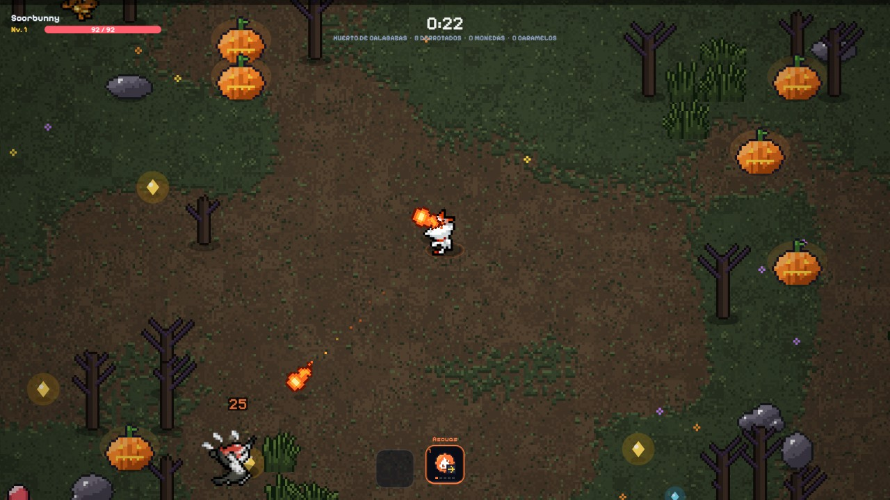
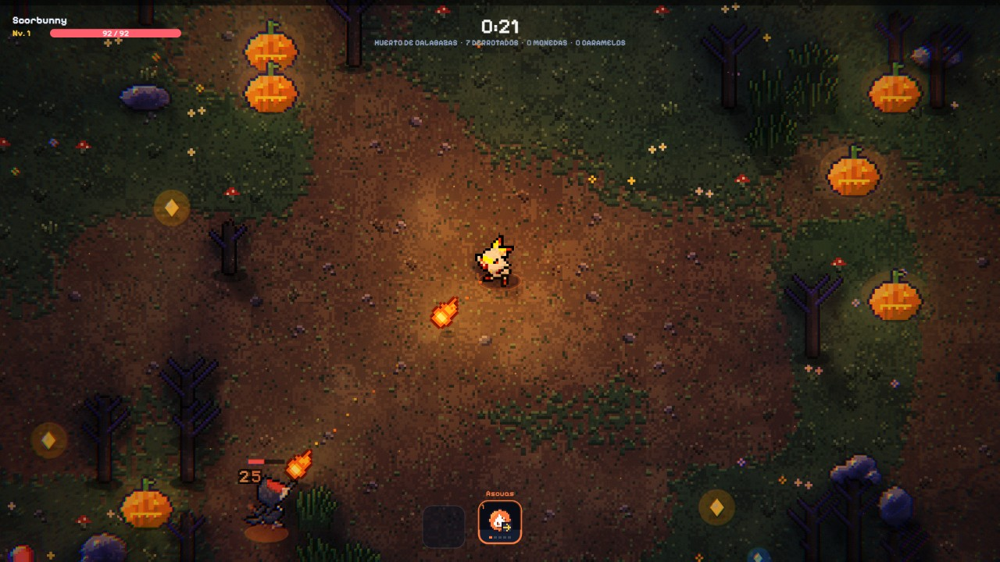
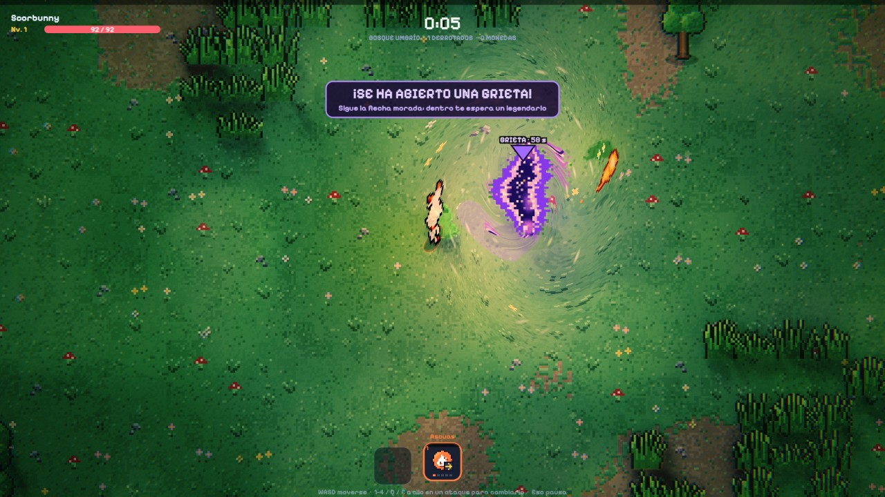

# PokéSurvivor · Luces y sombras

Extensión de navegador que añade iluminación en tiempo real a
[PokéSurvivor](https://pokesurvivor.com/) sin tocar el juego: sombras, luz que rebota, niebla,
agua con reflejos y un ambiente propio para cada escenario. Funciona en Chrome, Edge, Brave y
Opera, y solo se activa en pokesurvivor.com.

| Original | Con la extensión |
| --- | --- |
|  |  |

## Qué hace

- **Sombras** de la luna y de la luz del jugador, que se tiñe con el color de tu compañero.
  Tienen la altura de cada objeto, así que un árbol proyecta más sombra que una mata de hierba.
- **Iluminación global**: fuegos, calabazas, lava, cristales y ataques iluminan lo que tienen
  alrededor con su color.
- **Niebla suave con haces de luz**, partículas en el aire y luz de contorno en los personajes.
- **Agua viva**: cáusticas, burbujas, brillos y reflejos sobre toda la superficie, sin pintar
  nunca por encima del jugador.
- **Un ambiente distinto en cada escenario y en cada grieta**, con una transición suave al
  cambiar de zona.
- **Grietas con un shader propio**: el suelo de alrededor se retuerce hacia el vórtice.
- **Variantes de árboles, árboles secos, cristales, rocas y hierba**, pintadas con los mismos
  algoritmos y la paleta de cada zona del juego, no con dibujos nuevos.
- **Decoración del suelo**: flores, matas y piedrecitas que nunca salen en el agua.
- **Exposición automática**, para que ni las zonas claras ni las oscuras queden lavadas.

## Instalar

1. Descarga el `.zip` de la [última versión](../../releases/latest) y descomprímelo, o clona
   este repositorio.
2. Abre `chrome://extensions` (en Edge, `edge://extensions`).
3. Activa **Modo de desarrollador** (arriba a la derecha).
4. Pulsa **Cargar descomprimida** y elige la carpeta (la que tiene `manifest.json`).
5. Entra en https://pokesurvivor.com/ y juega.

## Uso

- **Icono de la extensión**: elige el ambiente (noche, atardecer, día u original) y activa o
  desactiva las variantes y la decoración. Los cambios se aplican al momento, sin recargar.
- **Tecla L** durante la partida: pasa al siguiente ambiente (el menú se actualiza solo).

## Bueno saber

- Si algo falla (un driver gráfico raro, pérdida del contexto WebGL), la extensión se apaga
  sola y se ve el juego normal.
- Respeta la opción del sistema «reducir movimiento»: sin relámpagos, sin aire que tiembla y
  sin vórtice en las grietas.
- La calidad baja sola si los FPS caen.
- No envía nada a ningún sitio. Solo guarda los tres ajustes del menú en el almacenamiento del
  navegador (si tienes la sincronización activada, el navegador los copia entre tus equipos).

## Archivos

| Archivo | Para qué sirve |
| --- | --- |
| `manifest.json` | Declaración de la extensión (Manifest V3) |
| `lighting.js` | La iluminación; se ejecuta en la página para engancharse al canvas del juego |
| `props.js` | Variantes de árboles, rocas y hierba |
| `bridge.js` | Pasa los ajustes del menú a la página |
| `popup.html`, `popup.css`, `popup.js` | El menú |
| `icons/`, `fonts/` | Iconos y la fuente pixel del juego |

## Licencia y créditos

- **PokéSurvivor** es de [JPTER78](https://github.com/JPTER78/pokesurvivor). `props.js` adapta
  los pintores de objetos de su código, que se publica bajo la
  [PolyForm Noncommercial 1.0.0](https://polyformproject.org/licenses/noncommercial/1.0.0/).
  Por eso esta extensión se distribuye con la misma licencia: puedes usarla, estudiarla y
  modificarla, pero **no con fines comerciales**. Detalles y avisos en [LICENSE.md](LICENSE.md).
- **Pixelify Sans** está bajo la SIL Open Font License ([fonts/OFL.txt](fonts/OFL.txt)).
- Pokémon y sus nombres son marcas de Nintendo, Creatures Inc. y GAME FREAK inc.

Proyecto de fan sin ánimo de lucro. No está afiliado ni respaldado por el autor de PokéSurvivor
ni por los titulares de Pokémon.
