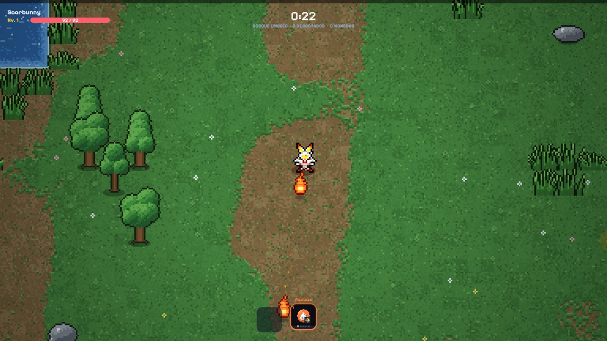
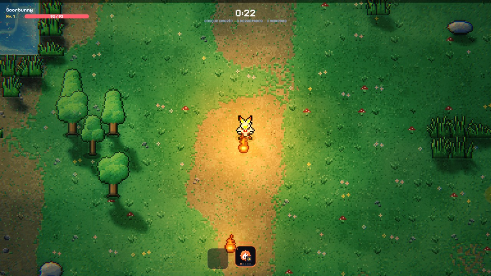
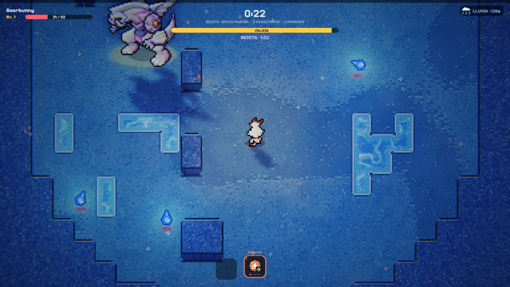

# PokéSurvivor · Lights & Shadows

A browser extension that adds real-time lighting to [PokéSurvivor](https://pokesurvivor.com/):
shadows, bouncing light, fog, water reflections and a unique mood for every area. It doesn't
change the game itself, and it only runs on pokesurvivor.com.

| Original | With the extension |
| --- | --- |
|  |  |

## How to install

You don't need a GitHub account or any technical knowledge. It takes about two minutes.

Works in **Chrome, Edge, Brave and Opera** on a computer (not on phones, and not in Firefox or
Safari).

### 1. Download it

**[⬇ Click here to download `pokesurvivor-luces.zip`](https://github.com/PelayoNaredo/pokesurvivor-luces/releases/latest/download/pokesurvivor-luces.zip)**

The file goes to your **Downloads** folder.

### 2. Unzip it

- **Windows:** right-click the file → **Extract All…** → **Extract**.
- **Mac:** double-click the file.

You now have a folder called `pokesurvivor-luces`. Leave it somewhere you won't delete it
(for example, your Documents folder): the browser loads the extension from there every time.

### 3. Open the extensions page

Copy this into the address bar and press Enter:

- Chrome: `chrome://extensions`
- Edge: `edge://extensions`
- Brave: `brave://extensions`
- Opera: `opera://extensions`

### 4. Turn on Developer mode

Find the **Developer mode** switch (top right in Chrome, on the left side in Edge) and turn it on.
This only lets you install extensions from a folder on your computer; it doesn't change anything
else.

### 5. Load the folder

Click **Load unpacked** and choose the `pokesurvivor-luces` folder from step 2. Pick the folder
that contains `manifest.json`; if you see another `pokesurvivor-luces` folder inside, choose that
inner one.

The extension appears in the list with a little moon icon. Done!

### 6. Play

Go to **https://pokesurvivor.com/** and start a game. If the page was already open, reload it.

> **Tip:** click the puzzle piece icon next to the address bar and pin the moon so you can
> reach the menu in one click.

## Using it

- **Moon icon:** pick the mood (**Noche** = night, **Atardecer** = sunset, **Día** = day,
  **Original** = no lighting) and turn tree/rock/grass variants and ground decoration on or off.
  Changes apply instantly, no reload needed. (The menu is in Spanish.)
- **L key** during a game: switch to the next mood.

## Updating

Download the zip again, unzip it over the old folder (replace the files), then on the extensions
page click the reload arrow on the extension's card.

## Uninstalling

On the extensions page, click **Remove** on the extension's card. You can then delete the folder.

## What it does

- **Shadows with the real shape of every object**, from the moon and from the player's light
  (which takes on your partner Pokémon's colour). Each sprite is projected from its feet, so a
  dead tree casts its branches and a Pokémon its ears. Shadows are sharp at the base and get
  softer the higher the part that casts them, and everything gets a contact shadow where it
  touches the ground.
- **Volume on sprites:** every sprite gets a normal map generated from its silhouette and
  shading, so light wraps around it instead of just brightening it.
- **Real point lights:** anything that glows (fire attacks, embers, gems) becomes a light
  that falls off with distance like a real one, lights each sprite on the side facing it and
  makes the fog around it glow.
- **Bounced light with Radiance Cascades:** fires, lava, crystals and attacks light up their
  surroundings in their own colour, blocked by whatever stands in the way. No noise, no
  smearing when you move.
- **Light that respects the pixel art:** on the ground, light is worked out once per art pixel
  and steps in soft bands, like hand-shaded pixel art, instead of a smooth filter on top.
- **Materials:** crystals and gems glint, rocks shine a little, fur and leaves stay matte.
- **Clouds** drift over the moon and slide huge, slow shadows across open areas.
- **Soft fog with light shafts**, floating particles and rim light on characters.
- **Living water:** caustics, bubbles, glints, drifting clouds reflected on the whole surface,
  and reflections of whatever stands on the water or by its shore.
- **A different mood in every area and every rift**, with smooth transitions between them.
- **Rifts get their own shader:** the ground around them twists into the vortex.
- **Variants of trees, dead trees, crystals, rocks and grass**, drawn with the game's own
  painting code and each area's palette, not with new artwork.
- **Ground decoration:** flowers, tufts and pebbles that never show up in water.
- **Auto exposure**, so neither bright nor dark areas look washed out.

## Good to know

- If something goes wrong (an unusual graphics driver, the WebGL context getting lost), the
  extension switches itself off and you see the normal game.
- It respects your system's "reduce motion" setting: no lightning, no heat shimmer and no
  vortex in the rifts.
- Quality adapts to your screen: if the game stops keeping up with your monitor's refresh rate
  (60, 120, 144 Hz...), it steps down, and it only steps back up when there is room to spare.
- It doesn't send anything anywhere. It only stores the three menu settings in your browser
  (if you have browser sync on, the browser copies them between your devices).
- Chrome may show a notice about developer-mode extensions when it starts. That's normal for
  anything installed this way; you can close it.

## Files

| File | Purpose |
| --- | --- |
| `manifest.json` | Extension declaration (Manifest V3) |
| `lighting.js` | The lighting; runs in the page to hook into the game's canvas |
| `props.js` | Tree, rock and grass variants |
| `bridge.js` | Passes the menu settings to the page |
| `popup.html`, `popup.css`, `popup.js` | The menu |
| `icons/`, `fonts/` | Icons and the game's pixel font |

## License and credits

- **PokéSurvivor** is made by [JPTER78](https://github.com/JPTER78/pokesurvivor). `props.js`
  adapts the object painters from its code, which is released under the
  [PolyForm Noncommercial 1.0.0](https://polyformproject.org/licenses/noncommercial/1.0.0/)
  license. That's why this extension uses the same license: you can use, study and modify it,
  but **not for commercial purposes**. Details and notices in [LICENSE.md](LICENSE.md).
- **Pixelify Sans** is under the SIL Open Font License ([fonts/OFL.txt](fonts/OFL.txt)).
- Pokémon and its names are trademarks of Nintendo, Creatures Inc. and GAME FREAK inc.

This is a non-profit fan project. It is not affiliated with or endorsed by the author of
PokéSurvivor or by the Pokémon rights holders. It is provided as is, without any warranty;
use it at your own risk.
